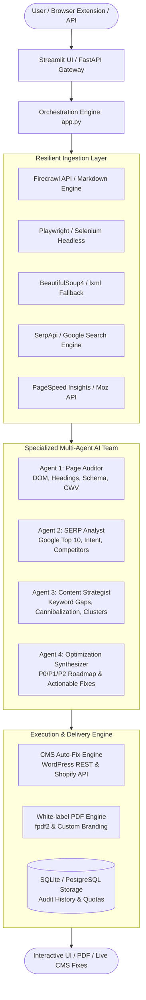

# 🚀 AI SEO Audit Team — Autonomous Multi-Agent SEO Intelligence Platform

[](https://www.python.org/)
[](https://aistudio.google.com/)
[](https://streamlit.io/)
[](https://fastapi.tiangolo.com/)
[](https://playwright.dev/)
[](LICENSE)

An enterprise-grade, autonomous **Multi-Agent SEO Intelligence and Remediation Platform**. It orchestrates specialized AI agents to execute deep technical on-page auditing, Google SERP competitive reverse-engineering, Core Web Vitals telemetry, automated CMS remediation (WordPress & Shopify), and white-label executive PDF reporting.

Built with modern software engineering practices: modular agent decoupling, resilient fallback scrapers, exponential backoff rate-limit handling, multi-tenant FastAPI endpoints, and an interactive Streamlit analytics suite.

---

## 📌 Executive Summary & Key Highlights

* **Autonomous Multi-Agent Architecture**: Decouples auditing tasks across specialized agents (Page Auditor, SERP Analyst, Content Strategist, and Report Synthesizer) with rate-limit protection and token budget control.
* **43 Production-Ready SEO Features**: From technical Core Web Vitals and Schema validation to keyword cannibalization, toxic backlink heuristics, and topic clustering.
* **Autonomous CMS Auto-Fix Engine**: Directly pushes code and content patches (missing meta tags, title fixes, image alt text) to **WordPress** and **Shopify** stores via REST/GraphQL connectors.
* **Real-Time SERP Intelligence**: Scrapes and analyzes live Google search results to determine search intent, snippet opportunities, and competitor gap metrics.
* **Multi-Modal Client Interfaces**: Includes an interactive **Streamlit Dashboard**, a headless **FastAPI backend** with tiered API key quotas, and a native **Chrome Extension** for 1-click in-browser audits.
* **White-Label PDF Generator**: Programmatic client-ready report generation via `fpdf2` with custom brand palette, logo, and ROI calculation metrics.

---

## 🏗️ System Architecture & Workflow



---

## 💼 Resume & Engineering Highlights

For technical recruiters and engineering leaders, here is a snapshot of core engineering capabilities demonstrated in this project:

| Engineering Area | Implementation Details |
| :--- | :--- |
| **Agentic AI & LLMs** | Prompt-engineered LLM workflows powered by Google Gemini (2.0-Flash / 1.5-Pro) with JSON schema validation, automated retries on 429 quota limits, and multi-agent coordination. |
| **Resilient Web Scraping** | 3-tier fallback data ingestion pipeline: **Firecrawl API** (markdown conversion) $\rightarrow$ **Playwright/Selenium** (dynamic JavaScript execution) $\rightarrow$ **BeautifulSoup4** (lightweight DOM extraction). |
| **Automated Remediation** | Production-ready CMS integration engine that programmatically executes CRUD updates on WordPress (`wp-json/wp/v2`) and Shopify via authenticated API sessions. |
| **Scalable API Architecture** | Built a multi-tenant **FastAPI** microservice featuring SQLite token-bucket rate limiting, Tier authentication (`free`, `pro`, `enterprise`), and endpoint telemetry. |
| **Data Visualization & UX** | Designed a responsive **Streamlit** dashboard featuring multi-page routing, real-time audit progress indicators, Plotly competitive graphs, and custom CSS theming. |
| **Enterprise Reliability** | Implemented exponential backoff retry algorithms, defensive timeout handling, and atomic database transactions. |

---

## ⚡ The 6 Core Pillars & 43 Features

### 1. 🤖 Autonomous Multi-Agent Engine
* **Page Auditor Agent**: Deep DOM extraction, heading hierarchy validation, alt-text coverage, canonical checks.
* **SERP Competitive Analyst**: Evaluates top 10 SERP competitor strategies, title patterns, and search intent.
* **Content Strategist Agent**: Identifies topical gaps, semantic opportunities, and content outlines.
* **Optimization Advisor**: Synthesizes findings into prioritized P0/P1/P2 roadmaps.

### 2. ⚡ Technical SEO & Core Web Vitals
* **Google PageSpeed Insights API**: Real-time telemetry for LCP, FID/INP, and CLS scores.
* **Schema Markup Validator**: Validates JSON-LD, Microdata, and OpenGraph schemas against Schema.org standards.
* **JavaScript Rendering Tester**: Detects hydration and client-side rendering indexing issues.
* **Security & SSL Auditor**: Checks HTTPS configurations, HSTS headers, and SSL certificate expiration.
* **Mobile-Friendly Verifier**: Responsive viewport verification and tap-target accessibility checks.

### 3. 🔍 SERP & Competitor Intelligence
* **Competitor Discovery & Gap Analysis**: Uncovers real-time organic competitors for target keywords.
* **Search Volume & Trend Forecaster**: Evaluates seasonal volume swings and Google Trends trajectories.
* **SERP Feature Hunter**: Pinpoints Featured Snippet, People Also Ask (PAA), and Video Carousel opportunities.
* **Backlink & Domain Authority**: Integration with Moz API to gauge referring domains and toxic link risks.

### 4. 📝 Semantic Content Intelligence
* **Keyword Cannibalization Finder**: Flags internal pages competing for identical search queries.
* **Topic Clustering Engine**: Maps semantic parent-child topic clusters to build topical authority.
* **AI Content Outline & Article Generator**: Produces SEO-optimized outlines and complete draft articles.
* **Internal Linking Optimizer**: Analyzes anchor text distributions and orphan page risks.

### 5. 🛠️ Autonomous CMS Auto-Fix
* **WordPress REST API Connector**: Authenticates via Application Passwords to automatically update post titles, excerpts, meta descriptions, and featured images.
* **Shopify Store Connector**: Programmatically updates product descriptions, SEO titles, and handle redirects.
* **One-Click Auto-Fix Engine**: Reviews detected issues (e.g., missing meta description) and applies fixes directly to the CMS.

### 6. 📊 Commercial Architecture & White-Label Reporting
* **White-Label PDF Generator**: Generates pixel-perfect executive PDF audit reports (`fpdf2`) with custom brand colors, logos, and agency tags.
* **Stripe Subscription Billing**: Subscription tiers and webhook listeners for monetized SaaS usage.
* **Automated Audit Scheduler**: Cron-based background auditing with email dispatch for continuous monitoring.
* **Chrome Extension**: Lightweight Chrome extension (`Manifest V3`) enabling one-click URL auditing from the browser toolbar.

---

## 📁 Repository Structure

```
ai_seo_audit_team/
├── agent.py                 # Core Google ADK / Gemini agent runner
├── app.py                   # Main orchestration engine & audit pipelines
├── web_app.py               # Streamlit interactive web application
├── seo_engine.py            # Lightweight fallback analysis engine
├── config.py                # Configuration constants, niche templates & brand styling
├── test_all_features.py     # Comprehensive 43-feature integration test suite
├── whitelabel_config.json   # White-label branding metadata configuration
├── requirements.txt         # Root project Python dependencies
├── .env.example             # Clean environment variables configuration template
├── LICENSE                  # MIT Open Source License
│
├── agents/                  # Multi-Agent specialized intelligence team
│   ├── page_auditor.py      # On-page DOM, meta, and technical extractor
│   ├── serp_analyst.py      # Competitive search engine analyst
│   ├── content_analyzer.py  # Content depth & topic gap analyzer
│   ├── content_writer.py    # AI content generator
│   ├── strategy_writer.py   # Prioritized recommendation builder
│   └── report_generator.py  # Markdown and structured report compiler
│
├── features/                # 43 Modular feature implementations
│   ├── auto_fix.py          # Auto-remediation engine
│   ├── competitor_discovery.py # Organic competitor identification
│   ├── page_speed.py        # Core Web Vitals telemetry
│   ├── schema_validator.py  # Structured data validator
│   ├── internal_linking.py  # Internal link graph analysis
│   ├── toxic_links.py       # Suspicious backlink heuristics
│   ├── keyword_cannibalization.py # Query conflict detector
│   ├── whitelabel.py        # Brand PDF customization
│   └── ...                  # Additional modular features
│
├── cms_integration/         # Autonomous CMS Connectors
│   ├── auto_fix_engine.py   # Automated patch dispatcher
│   ├── wordpress_api.py     # WordPress REST API adapter
│   └── shopify.py           # Shopify REST/GraphQL connector
│
├── chrome_extension/        # Browser Extension (Manifest V3)
│   ├── manifest.json        # Extension configuration
│   ├── popup.html           # Extension UI modal
│   ├── popup.js             # Extension interaction controller
│   └── content.js           # Browser DOM reader
│
├── api/                     # Headless REST Microservice
│   ├── main.py              # FastAPI application with API key auth & quotas
│   └── requirements.txt     # Microservice dependencies
│
├── workflows/               # Reusable orchestration pipelines
│   ├── single_page.py       # Single-URL fast audit
│   ├── batch_audit.py       # Multi-URL batch processing
│   ├── full_site.py         # Full-site crawler & sitemap traversal
│   └── competitor_analysis.py # Competitor benchmark workflow
│
├── utils/                   # Shared technical utilities
│   ├── scraper.py           # Headless scraping & parsing fallback
│   ├── pdf_generator.py     # White-label PDF export engine
│   ├── rate_limiter.py      # Token & request rate limiting
│   ├── retry_handler.py     # Exponential backoff handler
│   └── db_manager.py        # SQLite persistence layer
│
├── pages/                   # Multi-page Streamlit views
│   └── 2_Competitor_Analysis.py # Dedicated competitor comparison view
│
└── examples/                # Sample outputs & benchmarks
    └── sample_audit_report.md # Real output sample for Shopify Blog audit
```

---

## 🛠️ Quick Start & Installation

### 1. Prerequisites
* Python 3.10 or higher
* Google Gemini API Key ([Get one for free at Google AI Studio](https://aistudio.google.com/))

### 2. Clone & Environment Setup
```bash
# Clone the repository
git clone https://github.com/Vaibhav1376/ai-seo-audit-team.git
cd ai-seo-audit-team

# Create and activate virtual environment
python -m venv venv

# Windows:
venv\Scripts\activate
# macOS/Linux:
# source venv/bin/activate

# Install dependencies
pip install -r requirements.txt
```

### 3. Configure Environment Variables
Copy the template configuration and supply your keys:
```bash
cp .env.example .env
```
Open `.env` in your editor and add your `GOOGLE_API_KEY`:
```ini
GOOGLE_API_KEY=your_gemini_api_key_here
SELECTED_MODEL=gemini-2.0-flash
FIRECRAWL_API_KEY=your_optional_firecrawl_key
SERPAPI_KEY=your_optional_serpapi_key
```

### 4. Run the Streamlit Dashboard
```bash
streamlit run web_app.py
```
Visit `http://localhost:8501` in your browser. Enter any target URL and click **Run Audit**.

---

## 🚀 Running the API & Verification

### Launch FastAPI Microservice
```bash
uvicorn api.main:app --host 0.0.0.0 --port 8000 --reload
```
Interactive Swagger documentation is available at `http://localhost:8000/docs`.

#### Sample API Request
```bash
curl -X POST "http://localhost:8000/audit/single" \
     -H "Content-Type: application/json" \
     -H "X-API-Key: YOUR_API_KEY" \
     -d '{"url": "https://example.com", "niche": "ecommerce"}'
```

### Run Feature Verification Suite
The repository includes an end-to-end test script covering all core audit features:
```bash
python test_all_features.py
```

### Verify API Authentication
```bash
python test_api_key.py
```

---

## 🧩 Chrome Extension Setup

1. Open Google Chrome and navigate to `chrome://extensions/`.
2. Toggle on **Developer mode** in the top right.
3. Click **Load unpacked** and select the [`chrome_extension`](file:///c:/Users/ADMIN/Desktop/Agents/ai_seo_audit_team/chrome_extension) folder.
4. Open any website in your browser, click the AI SEO Audit extension icon, and trigger an instant page audit.

---

## 📄 Sample Output
Check out [`examples/sample_audit_report.md`](examples/sample_audit_report.md) for a complete, realistic markdown output generated from auditing the Shopify Blog.

---

## 📜 License

Distributed under the MIT License. See [`LICENSE`](LICENSE) for more information.

---

## 👨‍💻 Author

**Vaibhav Kakad**  
* GitHub: [@Vaibhav1376](https://github.com/Vaibhav1376)  
* Email: [vaibhavkakad76@gmail.com](mailto:vaibhavkakad76@gmail.com)
